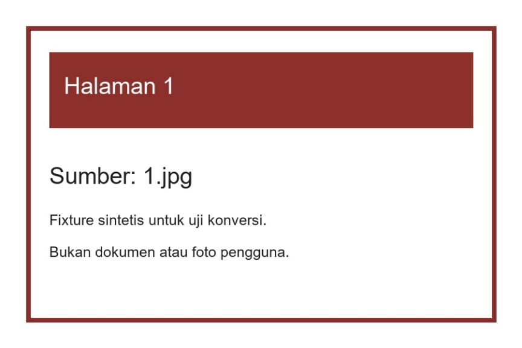

# Image Batch to PDF

Gabungkan gambar JPG, JPEG, dan PNG dalam satu folder menjadi PDF. Urutan nama dibaca secara natural: `1.jpg`, `2.jpg`, lalu `10.jpg`. Semua proses berjalan di komputer lokal.



[Halaman kedua](docs/images/pdf-page-2.png) · [Halaman ketiga](docs/images/pdf-page-3.png).

Preview di atas dirender dari PDF yang benar-benar dibuat oleh CLI. Gambar masukannya adalah fixture sintetis, bukan dokumen atau foto pengguna. Aplikasi ini memakai terminal dan tidak memiliki GUI.

## Menjalankan

Gunakan Python 3.11 atau lebih baru. Contoh PowerShell berikut menyimpan proyek di drive D:

```powershell
Set-Location D:\
git clone https://github.com/zalamanga/image-batch-to-pdf.git
Set-Location .\image-batch-to-pdf
python -m venv .venv
.\.venv\Scripts\python.exe -m pip install -r requirements.txt
```

Siapkan folder berisi gambar. Periksa urutannya terlebih dahulu:

```powershell
.\.venv\Scripts\python.exe image_batch_to_pdf.py .\gambar --list
```

Buat PDF baru pada folder tujuan yang sudah ada:

```powershell
.\.venv\Scripts\python.exe image_batch_to_pdf.py .\gambar .\katalog.pdf
```

Contoh urutan yang dilaporkan CLI:

```text
001  1.jpg
002  2.jpg
003  10.jpg
PDF tersimpan: katalog.pdf (3 halaman).
```

File input tidak diubah. PDF yang sudah ada ditolak; gunakan nama lain atau tambahkan `--overwrite` jika memang ingin menggantinya. `--list` hanya memeriksa file dan urutan, tanpa membuat PDF. Program mengembalikan exit code `0` saat berhasil dan `2` untuk kegagalan konversi yang dilaporkan.

## Perilaku dan batas

- Hanya gambar langsung di dalam folder yang diambil; subfolder dan ekstensi lain diabaikan. Nama nonangka seperti `halaman2.png` juga didukung. Nama yang setara secara natural diurutkan lagi berdasarkan teks nama, agar hasilnya tetap konsisten.
- JPEG/PNG harus dapat dibaca sebagai gambar satu frame. PNG animasi, file rusak, serta tautan simbolis ditolak.
- Orientasi EXIF diterapkan. Transparansi menjadi putih; gambar grayscale/CMYK dikonversi ke RGB. Metadata EXIF gambar tidak diteruskan, dan profil warna tidak dipertahankan sebagai pengelolaan warna khusus.
- Maksimal 100 gambar, 10 juta piksel per gambar, 40 juta piksel total, dan 100 MiB ukuran file input total. Batch lebih besar perlu dibagi. Semua halaman RGB ditahan di memori selama penyimpanan; batas piksel ini membatasi beban, bukan jaminan pemakaian RAM yang persis.
- Default `--dpi 150`. Nilai 36 sampai 600 mengatur ukuran fisik halaman PDF tanpa mengubah jumlah piksel gambar. Contoh gambar 900 × 600 pada 150 DPI menghasilkan halaman 6 × 4 inci.

PDF berisi gambar, tanpa OCR atau teks yang dapat dicari. Pillow menyimpan halaman RGB dengan kompresi JPEG; hasilnya tidak dijanjikan lossless. Ukuran PDF juga tidak selalu lebih kecil dari kumpulan input.

PDF ditulis ke file sementara pada folder tujuan, di-flush, lalu dipublikasikan setelah penyimpanan selesai. Mode default memakai hard link agar proses lain yang lebih dahulu membuat nama tujuan tidak tertimpa. Gunakan filesystem yang mendukung hard link, seperti NTFS. Jika tidak didukung, program melaporkan kegagalan dan tidak membuat tujuan; `--overwrite` memakai penggantian file secara eksplisit. Kegagalan penulisan sebelum publikasi mempertahankan PDF lama.

Jika Windows menolak penghapusan file sementara, program menampilkan lokasinya untuk diperiksa setelah file tidak lagi dipakai. PDF yang sudah berhasil dipublikasikan tetap dilaporkan berhasil; kegagalan pembersihan tidak menyamar sebagai kegagalan konversi.

Gunakan pada folder lokal yang tidak sedang diubah oleh proses lain. Pemeriksaan ukuran/waktu perubahan menangkap perubahan input yang teramati, tetapi alat ini tidak dirancang sebagai layanan unggahan untuk file tak tepercaya.

## Alur kode dan pengujian

[docs/CODE_FLOW.md](docs/CODE_FLOW.md) menjelaskan pemeriksaan batch, dekode, orientasi, dan penyimpanan hasil.

```powershell
.\.venv\Scripts\python.exe -m pip install -r requirements-dev.txt
.\.venv\Scripts\python.exe -m unittest discover -s tests -v
```

Seluruh 21 tes lulus pada Python 3.13 dan Pillow 13. Pengujian memeriksa urutan halaman PDF nyata, orientasi, alpha/palet, grayscale/CMYK, ukuran halaman, input rusak/animasi, batas sumber daya, input berubah, output lama, benturan penulis lain, serta pembersihan yang ditolak filesystem. Parser PDF hanya menjadi dependency pengujian; penggunaan CLI cukup dengan Pillow.

## Asal proyek

Perapihan dari skrip lokal `jpg_to_pdf.py` yang awalnya hanya menerima nama JPG numerik dan selalu menulis `katalog.pdf`. Scraper serta spreadsheet kerja yang berada di folder asal tidak disertakan. Tidak ditemukan identitas author, remote Git, atau lisensi skrip awal. [NOTICE.md](NOTICE.md) mencatat asal serta dependency tanpa membuat klaim lisensi baru.

Rujukan perilaku format: [Pillow PDF](https://pillow.readthedocs.io/en/stable/handbook/image-file-formats.html#pdf) dan [EXIF transpose](https://pillow.readthedocs.io/en/stable/reference/ImageOps.html#PIL.ImageOps.exif_transpose).
