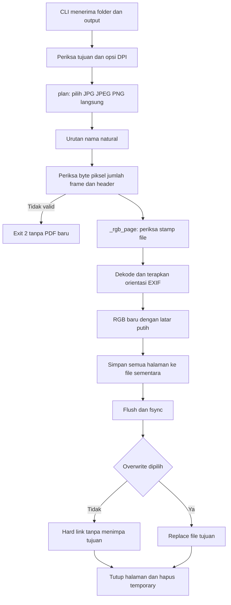

# Alur konversi gambar

Semua fungsi utama ada di [image_batch_to_pdf.py](../image_batch_to_pdf.py). `plan()` mengembalikan daftar `Page` dengan ukuran dan fingerprint file. Batas diperiksa sebelum semua halaman RGB dimuat. `--list` berhenti setelah tahap ini dan tidak menjamin bahwa seluruh dekode JPEG akan berhasil; file yang rusak pada bagian data juga dapat gagal saat konversi.

`_rgb_page()` membuka ulang file dan memeriksa device/inode, byte, waktu perubahan, dimensi serta frame. `ImageOps.exif_transpose` menerapkan arah foto. Halaman RGB baru hanya menerima piksel gambar, dengan transparansi ditempel pada latar putih. Objek gambar perantara ditutup; daftar RGB final tetap berada di memori sampai PDF selesai.

`convert()` tidak menulis tujuan sebelum Pillow menyelesaikan file sementara dan `fsync` berhasil. Hard link default menolak tujuan yang dibuat proses lain di sela pemeriksaan. Opsi overwrite sengaja mengganti file tujuan dengan hasil lengkap. `finally` menutup seluruh halaman dan mencoba membersihkan temporary pada jalur berhasil maupun gagal. Jika filesystem menolak pembersihan, peringatan menyebut lokasinya; flag publikasi memastikan PDF yang sudah tersimpan tetap berhasil dan error konversi sebelumnya tidak tertutup. Jaminan ini bukan transaksi lintas file atau jaminan ketahanan terhadap semua kegagalan listrik/filesystem.

[tests/test_conversion.py](../tests/test_conversion.py) memakai gambar sintetis dan membuka PDF hasilnya untuk memeriksa halaman, warna serta dimensi. Fault injection memeriksa simpan gagal dan benturan publikasi; tes itu tidak mengklaim telah mematikan disk atau menguji semua filesystem.
